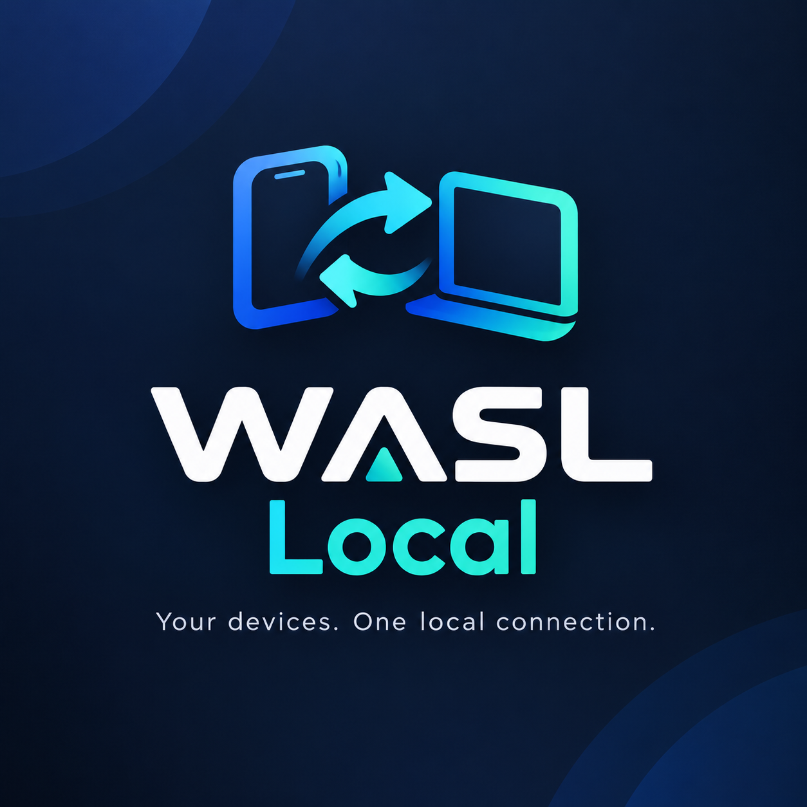

# WASL Local - وَصْل 🌐
> **حلٌ محلي فائق السرعة والأمان للربط والمشاركة الفورية بين الهاتف والحاسوب على الشبكة المحلية دون إنترنت**

<p align="center">
  
</p>

<p align="center">
  
  
  
  
</p>

---

## 📑 فهرس المحتويات
1. [نظرة عامة وفلسفة المشروع](#-نظرة-عامة-وفلسفة-المشروع)
2. [المميزات والخصائص الجوهرية](#-المميزات-والخصائص-الجوهرية)
3. [خطة الشمول لجميع أنظمة التشغيل (Multi-Platform Plan)](#-خطة-الشمول-لجميع-أنظمة-التشغيل-multi-platform-plan)
4. [خطة التجاوب مع جميع الشاشات (Adaptive & Responsive UI)](#-خطة-التجاوب-مع-جميع-الشاشات-adaptive--responsive-ui)
5. [معمارية النظام المستقل (Self-Contained Architecture)](#-معمارية-النظام-المستقل-self-contained-architecture)
6. [منظومة الأمان والخصوصية (Security Hardening)](#-منظومة-الأمان-والخصوصية-security-hardening)
7. [طريقة التشغيل والتطوير (Getting Started)](#-طريقة-التشغيل-والتطوير-getting-started)
8. [أوامر بناء حزم التثبيت للأنظمة (Building & Packaging)](#-أوامر-بناء-حزم-التثبيت-للأنظمة-building--packaging)
9. [خارطة الطريق المستقبلية (Future Roadmap)](#-خارطة-الطريق-المستقبلية-future-roadmap)

---

## 🎯 نظرة عامة وفلسفة المشروع
صُمم **WASL Local (وَصْل)** لكسر الحاجة إلى التطبيقات السحابية أو خدمات الإنترنت الخارجية لنقل ملف، مشاركة رابط، مزامنة الحافظة، أو عرض شاشة الحاسوب على الهاتف. 

يعمل التطبيق بالكامل داخل شبكة الواي فاي المنزلية أو نقطة اتصال الهاتف المحمول (**Mobile Hotspot**)، حيث تبقى بياناتك مشفرة ومحصورة بين أجهزتك فقط دون أن يخرج أي بايت إلى خوادم خارجية، مع خاصية **التطهير الفوري للجلسة (Ephemeral Session Purge)** لمسح كافة الآثار والبيانات بمجرد الانتهاء.

---

## ✨ المميزات والخصائص الجوهرية

### 📱 1. تمييز الأدوار الذكي (Sender vs. Receiver & Host vs. Mobile)
- **واجهة مخصصة للهاتف (`MobileDashboard`)**: الهاتف يرى فوراً لوحة لمسية مخصصة للتحكم والإرسال ومشاهدة شاشة الحاسوب، دون إرباكه بنفس واجهة الحاسوب المكتبي.
- **تحديد صريح للمرسل والمستقبل**: وسم لوني واضح على كل ملف ورسالة (`📤 أرسلته أنت من هذا الجهاز` مقابل `📥 وارد من: [اسم الجهاز]`).
- **بروتوكول طلب الموافقة المسبقة (File Transfer Consent)**: إشعار استئذان يظهر على شاشة المستقبل قبل بدء تحميل الملف.

### ⚡ 2. سرعة فائقة ونقل غير محدود للملفات
- نقل ملفات مباشر عبر الشبكة المحلية بسرعات تصل لسرعة الراوتر القصوى (Gigabit / Wi-Fi 6).
- شريط تقدم مباشر يحسب النسبة المئوية وسرعة النقل بالـ MB/s والوقت المتبقي.
- لا توجد قيود على أحجام الملفات أو الامتدادات الشائعة (فيديو 4K، صور خام، مستندات مضغوطة).

### 🖥️ 3. مشاركة شاشة الحاسوب مع الهاتف (WebRTC Screen Cast)
- بث شاشة الحاسوب أو نافذة محددة بجودة عالية وزمن استجابة فائق الصغر عبر **WebRTC (DTLS-SRTP)**.
- قفل تلقائي للهاتف في وضع "المشاهدة" فقط، مع زر تشغيل ملء الشاشة على الهاتف لسهولة العرض.

### 📋 4. مزامنة الحافظة والنصوص الفورية
- نسخ ولصق النصوص والروابط بنقرة واحدة بين الحاسوب والهاتف.
- دعم محرك نسخ احتياطي ذكي (**Resilient Clipboard Helper**) يعمل بنجاح على هواتف الأندرويد والآيفون حتى في بيئات HTTP المحلية.
- سجل محادثات خفيف بأسلوب الفقاعات التفاعلية للملاحظات والروابط.

### 🧹 5. التطهير الفوري للجلسة (Ephemeral Purge)
- زر مدمج في الواجهة لمسح الجلسة بالكامل (`مسح الجلسة وحذف البيانات`).
- حذف تلقائي لجميع الملفات المرفوعة، وسجل الرسائل، والحافظة من السيرفر ومن ذاكرة المتصفح بضغطة واحدة.
- تنظيف آلي عند إغلاق التطبيق.

---

## 🌐 خطة الشمول لجميع أنظمة التشغيل (Multi-Platform Plan)

تهدف الخطة إلى تمكين تثبيت وتشغيل WASL Local بنقرة واحدة على أي جهاز يمتلكه المستخدم:

```
                               ┌────────────────────────────────┐
                               │           WASL Local           │
                               │        منظومة متعددة المنصات    │
                               └───────────────┬────────────────┘
                                               │
               ┌───────────────────────────────┴───────────────────────────────┐
               ▼                                                               ▼
    ┌──────────────────────┐                                        ┌──────────────────────┐
    │     أجهزة سطح المكتب  │                                        │  الهواتف واللوحيات   │
    │  (Desktop Platforms) │                                        │  (Mobile & Tablets)  │
    └──────────┬───────────┘                                        └──────────┬───────────┘
               │                                                               │
     ┌─────────┼─────────┐                                           ┌─────────┴─────────┐
     ▼         ▼         ▼                                           ▼                   ▼
  Windows    Linux     macOS                                      Android               iOS
  (.exe)  (.AppImage)  (.dmg)                                      (PWA)               (PWA)
```

| المنصة | نوع الحزمة | متطلبات التشغيل لدى المستخدم | كيفية التثبيت والاستخدام |
|--------|------------|-----------------------------|---------------------------|
| **Windows 10 / 11** | `WASL-Local-Setup.exe` (NSIS) ونسخة `Portable.exe` | لا شيء (المحرك مدمج ذاتياً) | تثبيت قياسي بنقرة واحدة، إنشاء اختصار على سطح المكتب وقائمة ابدأ. |
| **Linux (All Distros)** | `WASL-Local.AppImage` و `wasl-local.deb` | لا شيء | تشغيل مباشر بحزمة AppImage على Ubuntu, Debian, Fedora, Arch, Manjaro. |
| **macOS (Intel & ARM)** | `WASL-Local.dmg` (Universal) | لا شيء | سحب وإفلات في مجلد Applications مع دعم كامل لرقاقات M1/M2/M3. |
| **Android** | **PWA (Progressive Web App)** | متصفح Chrome أو Edge أو Samsung | فتح رابط QR والنقر على زر **"تثبيت التطبيق"** ليتحول لتطبيق مثبت على الشاشة الرئيسية بدون متصفح. |
| **iOS (iPhone/iPad)** | **PWA Standalone** | متصفح Safari | الضغط على "مشاركة" ثم **"إضافة إلى الشاشة الرئيسية"** ليعمل كتطبيق أصلي بملء الشاشة. |

---

## 📐 خطة التجاوب مع جميع الشاشات (Adaptive & Responsive UI)

تمت هندسة الواجهة وفق نظام تصميم ديناميكي يتكيف مع طبيعة الجهاز وأبعاد الشاشة:

```
┌──────────────────────────────────────────────────────────────────────────────────────────────────┐
│                                 تصنيف الشاشات وتكيف واجهة WASL                                  │
├─────────────────────┬──────────────────────┬─────────────────────────────────────────────────────┤
│ الفئة               │ الأبعاد المستهدفة    │ السلوك المعماري للواجهة                             │
├─────────────────────┼──────────────────────┼─────────────────────────────────────────────────────┤
│ شاشات سطح المكتب    │ ≥ 1024px             │ • شريط جانبي دائم (Sidebar)                         │
│ (Desktop / 4K)      │ (1080p, 2K, 4K)      │ • شبكة عرض متعددة الأعمدة (Grid Dashboard)          │
│                     │                      │ • منطقة سحب وإفلات واسعة ومباشرة للملفات            │
│                     │                      │ • معاينة جانبية للمستندات والصور                    │
├─────────────────────┼──────────────────────┼─────────────────────────────────────────────────────┤
│ الحواسيب المحمولة   │ 768px - 1023px       │ • شريط جانبي قابل للطي والتمدد الذاتي               │
│ والأجهزة اللوحية    │ (Laptops, iPad)      │ • أزرار وأهداف لمس واسعة (أدنى حد 44×44px)          │
│                     │                      │ • لوحات منقسمة (Split View) للتحكم السريع           │
├─────────────────────┼──────────────────────┼─────────────────────────────────────────────────────┤
│ الهواتف الذكية      │ ≤ 767px              │ • تفعيل واجهة الهاتف اللمسية (`MobileDashboard`)     │
│ (Smartphones)       │ (Portrait/Landscape) │ • شريط تنقل سفلي بإبهام اليد (Bottom Navigation)    │
│                     │                      │ • بطاقات وظيفية بأسلوب التطبيقات الحديثة            │
│                     │                      │ • شاشات وقوائم منبثقة من الأسفل (Bottom Sheets)     │
└─────────────────────┴──────────────────────┴─────────────────────────────────────────────────────┘
```

---

## 🏗️ معمارية النظام المستقل (Self-Contained Architecture)

في إصدار سطح المكتب، يعمل البرنامج كوحدة واحدة مكتملة دون الاعتماد على أدوات خارجية:

```
┌──────────────────────────────────────────────────────────────────────────────────┐
│                             WASL Local Desktop Core                              │
│                                                                                  │
│   ┌────────────────────────────────┐       ┌─────────────────────────────────┐   │
│   │     مُحرّك السيرفر المدمج       │       │       واجهة المستخدم المترجمة    │   │
│   │      Fastify Core Server       │       │        React + Vite (Built)     │   │
│   │      (server/dist/index.js)    │       │            (client/dist)        │   │
│   └───────────────┬────────────────┘       └────────────────┬────────────────┘   │
│                   │                                         │                    │
│                   ▼                                         ▼                    │
│          • معالجة API والمصادقة                  • خدمة الملفات الثابتة عبر       │
│          • خادم الـ WebSockets                  • منفذ موحد بالكامل              │
│          • إدارة تشفير الجلسات                                                   │
│                                                                                  │
│                 ═══════════════ المنفذ الموحد: 8080 ═══════════════              │
└───────────────────────────┬──────────────────────────────────┬───────────────────┘
                            │                                  │
                            ▼                                  ▼
                نافذة سطح المكتب (Electron)             الهاتف المحمول المقترن
                 http://localhost:8080                 http://192.168.x.x:8080
```

---

## 🔒 منظومة الأمان والخصوصية (Security Hardening)

تم اجتياز تدقيق أمني شامل وتصليب الكود بالمعايير التالية:

1. **مصادقة التوكن الإلزامية (`requireAuth`)**: لا يُسمح بأي وصول للملفات أو سجل النصوص أو الحافظة أو مسح الجلسة بدون توكن معتمد (`CSPRNG 32-byte hex`).
2. **الحماية الصارمة من Path Traversal**: مسار التحميل محمي ومحكوم بـ `path.resolve` لمنع التلاعب بالمسارات عبر `../` وحصر التخزين داخل مجلد `uploads/`.
3. **سياسة أمان المحتوى الصارمة (Content Security Policy - CSP)**: تقييد صارم للمصادر لمنع حقن السكريبتات الخبيثة (XSS).
4. **عزل بيئة Electron**:
   - `nodeIntegration: false` (منع كود الويب من استدعاء دوال النظام).
   - `contextIsolation: true` (عزل سياق التنفيذ).
   - `sandbox: true` (تشغيل النافذة في صندوق حماية نظام التشغيل).
   - منع فتح أي روابط خارجية داخل التطبيق وتوجيهها للمتصفح الافتراضي.
5. **مقاومة طوفان الرسائل (WS Flood Protection)**: تقييد رسائل الـ WebSocket لمنع إغراق الخادم بالطلبات.
6. **ترويسات أمان متقدمة**:
   - `X-Content-Type-Options: nosniff`
   - `X-Frame-Options: SAMEORIGIN`
   - `X-XSS-Protection: 1; mode=block`

---

## 🚀 طريقة التشغيل والتطوير (Getting Started)

### المتطلبات الأساسية للتطوير:
- **Node.js**: الإصدار 20 فما فوق
- **npm**: الإصدار 10 فما فوق

### خطوات التثبيت والتشغيل المحلي:

```bash
# 1. استنساخ المستودع
git clone https://github.com/BrahimBouhania-DZ/WASL-Local.git
cd WASL-Local

# 2. تثبيت الاعتماديات لجميع الحزم
npm install

# 3. تشغيل وضع التطوير الكامل (السيرفر والواجهة معاً)
npm run dev

# 4. أو تشغيل تطبيق سطح المكتب في بيئة التطوير
npm run electron:dev
```

- **رابط الواجهة على الحاسوب**: `http://localhost:5173`
- **رابط السيرفر والـ API**: `http://localhost:8080`

### تشغيل الاختبارات الآلية:
```bash
# تشغيل اختبارات الأمان والسيرفر
npm run test -w server
```

---

## 📦 أوامر بناء حزم التثبيت للأنظمة (Building & Packaging)

### 1. بناء حزمة نظام Linux (`.AppImage`):
```bash
npm run electron:build -- --linux AppImage
```
*الناتج:* ملف `dist-electron/WASL-Local-0.1.0.AppImage` يعمل مباشرة على أي توزيعة لينكس دون تثبيت.

### 2. بناء مثبت نظام Windows (`.exe`):
```bash
npm run electron:build -- --win nsis
```
*الناتج:* ملف `dist-electron/WASL-Local Setup 0.1.0.exe`.

### 3. بناء نسخة محمولة لنظام Windows (Portable):
```bash
npm run electron:build -- --win portable
```

### 4. بناء نسخة نظام macOS (`.dmg`):
```bash
npm run electron:build -- --mac dmg
```

---

## 🗺️ خارطة الطريق المستقبلية (Future Roadmap)

- [x] إعادة الهوية البصرية بالكامل باسم وشعار **WASL Local**.
- [x] بناء لوحة تحكم مخصصة للهاتف (`MobileDashboard`).
- [x] إبراز وتمييز هويات المرسل والمستقبل على الملفات والرسائل.
- [x] إضافة زر مسح الجلسة وتطهير البيانات الحساسة (`Session Purge`).
- [x] تصليب المنظومة الأمنية وفحص ثغرات Path Traversal و CSP و Token Auth.
- [ ] دمج خدمة الملفات الثابتة عبر `@fastify/static` لتوحيد المنفذ في الإنتاج.
- [ ] إضافة ملف `manifest.webmanifest` ودعم تثبيت PWA للأندرويد والآيفون.
- [ ] بناء وإطلاق أول حزمة رسمية لنظامي Linux و Windows على GitHub Releases.
- [ ] دعم التشفير الطرفي الكامل (End-to-End Encryption) لنقل الملفات الحساسة داخل الشبكة.

---

## 📄 الترخيص (License)
هذا المشروع مرخص تحت رخصة **MIT** - لك كامل الحرية في استخدامه وتطويره وتوزيعه.

<p align="center">
  <b>WASL Local (وَصْل)</b> — صُنع بأعلى معايير السرعة والأمان والخصوصية المحلية.
</p>
