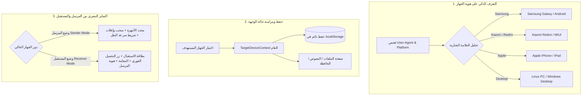

# وثيقة خطة تطوير تجربة الأجهزة والتمييز الدقيق بين المرسل والمستقبل
### LinkDesk Local - Device Identity, Sender/Receiver Differentiation & UI Clarity

---

## 1. نظرة عامة
تهدف هذه الخطة إلى حل المشاكل التي ظهرت في تجربة المستخدم أثناء ربط الأجهزة، وضبط هوية الجهاز بدقة متناهية، وبناء **واجهة متمايزة ومخصصة بالكامل للمستقبل تختلف عن واجهة المرسل**، بحيث يعرف كل طرف في أي وضع يتواجد وما هي الإجراءات المتاحة له بدون أي لبس.

---

## 2. المشاكل التي تم تشخيصها بدقة

1. **نصوص الترجمة المفقودة (`target.title`, `target.all`, `target.countSelected`)**:
   - ظهور المفاتيح البرمجية بدلاً من الكلمات العربية المناسبة بسبب غيابها في `ar.json` و `en.json` و `fr.json`.

2. **فقدان تحديد الجهاز عند التنقل بين الصفحات والعودة للوضع التلقائي**:
   - تخزين الجهاز المحدد داخل حالة محلية مؤقتة تنتهي بمجرد تغيير التبويب، وإعادة الضبط عند ورود أي تحديث للشبكة عبر WebSocket.

3. **الاسم العام المجهول `My Phone` وغياب هوية الجهاز**:
   - تسجيل الأجهزة باسم ثابت دون فحص نوع الجهاز وطرازه (Samsung, Xiaomi, iPhone, Windows, Linux).

4. **تشابه واجهة المرسل والمستقبل**:
   - المستقبل يرى نفس واجهة الرفع والسحب والإفلات، مما يربك المستخدم؛ بينما يجب أن يرى المستقبل **شاشة استقبال مركزة** تعرض ما وصل إليه، مع أزرار التحميل والمعاينة المباشرة، وحالة الإرسال القادم إليه من الجهاز المرسل.

---

## 3. المعمارية التفصيلية للحلول

---

## 4. بنود الخطة التنفيذية المفصلة

### المحور الأول: التعرف التلقائي على العلامة التجارية وهوية الأجهزة (Device Fingerprinting)
- **4.1 بناء مكتبة الكشف الذكي `client/src/utils/deviceDetector.ts`**:
  - تحليل `navigator.userAgent` و `navigator.platform` و `navigator.userAgentData`.
  - التعرف الدقيق على:
    - **Samsung**: مثل Galaxy S/A series.
    - **Xiaomi / Redmi / POCO**: كشف واجهة MIUI وموديلات شاومي.
    - **Apple iPhone / iPad**: كشف طراز iOS وإصدار Safari.
    - **Huawei / Honor / Google Pixel / OnePlus / Oppo / Vivo**.
    - **الحواسيب**: كشف Linux (Ubuntu/Debian)، Windows 10/11، و macOS.
- **4.2 تسجيل الجهاز بالاسم الصحيح عند أول اقتران**:
  - في صفحة [QRPairPage.tsx](file:///home/zro47/Desktop/app_local/linkdesk-local/client/src/pages/QRPairPage.tsx)، إرسال الاسم الحقيقي المكتشف بدلاً من `My Phone`.
- **4.3 إتاحة تعديل اسم الجهاز (Custom Nickname)**:
  - إمكانية نقر المستخدم على اسم جهازه لتعديله (مثلاً: "هاتف العمل" أو "حاسوب الغرفة").

---

### المحور الثاني: إدارة الوجهة المستهدفة بشكل دائم وثابت (Global Target Context)
- **2.1 بناء سياق `TargetContext.tsx`**:
  - تخزين `selectedTargetIds: string[]` في سياق عام على مستوى التطبيق بالكامل.
  - حفظ التحديد في `localStorage` (`linkdesk_target_device_ids`).
- **2.2 ثبات التحديد عبر التنقل**:
  - عند اختيار "Samsung S23" في صفحة الملفات، يظل هو الجهاز المحدد تلقائياً عند الانتقال إلى:
    - صفحة النصوص والروابط.
    - صفحة الحافظة.
    - إعادة تحميل الصفحة (Refresh).
  - لا يعود إلى "الجميع" إلا إذا قام المستخدم بالضغط على زر "الجميع" بنفسه.
- **2.3 تصحيح واستكمال ملفات الترجمة كاملة**:
  - إضافة كافة المفاتيح في `ar.json`, `en.json`, `fr.json`:
    - `target.title`: "وجهة الإرسال المحددة:"
    - `target.all`: "الجميع (بث عام لكافة الأجهزة)"
    - `target.allSelected`: "يتم الإرسال لجميع الأجهزة المقترنة"
    - `target.countSelected`: "أجهزة محددة"
    - `target.singleSelected`: "جهاز محدد"
    - `target.noOtherDevices`: "لا توجد أجهزة مقترنة أخرى حالياً"

---

### المحور الثالث: التمايز الجذري بين واجهة المرسل وواجهة المستقبل (Sender vs Receiver UI)
- **3.1 تمييز دور الجهاز الحالي بوضوح**:
  - شارة علوية واضحة تحدد هوية الجهاز الحالي: *(أنت الآن: حاسوب لينكس | متصل بـ: هاتف سامسونج)*.
- **3.2 واجهة مخصصة وموجهة للمستقبل (Receiver View)**:
  - عندما يرسل هاتف ملفاً أو نصاً إلى الحاسوب:
    - صفحة المستقبل تُبرز **"الملفات المستلمة مؤخراً من [اسم المرسل]"** في الواجهة الرئيسية بحجم واضح وتصميم بارز.
    - إظهار بطاقة استلام نشطة: اسم الملف، حجمه، نوعه، وزر **تحميل فوري بنقرة واحدة** وزر **معاينة بصرية**.
    - إخفاء أو تصغير منطقة السحب والإفلات غير المطلوبة للمستقبل في تلك اللحظة لمنع التشتت.
- **3.3 واجهة مخصصة للمرسل (Sender View)**:
  - إظهار منطقة الإرسال، محدد الأجهزة، شريط تقدم الرفع والسرعة، وحالة موافقة المستقبل.
- **3.4 علامات ورموز الأجهزة (Visual Device Badges)**:
  - أيقونة خاصة بكل جهاز (شعار هاتف، حاسوب، أو لوحي) مع نقطة حالة الاتصال (أخضر للمتصل اللحظي / رمادي للمنقطع).

---

## 5. جدول مقارنة واجهة المرسل مقابل واجهة المستقبل

| العنصر | ما يظهر للمرسل (Sender) | ما يظهر للمستقبل (Receiver) |
| :--- | :--- | :--- |
| **العنوان الرئيسي** | "إرسال ملفات إلى [اسم المستلم]" | "الملفات المستلمة من [اسم المرسل]" |
| **المنطقة البارزة** | منطقة السحب والإفلات وقائمة الملفات المراد رفعها | بطاقات الملفات الواصلة حديثاً مع المعاينة والتحميل |
| **شريط التقدم** | شريط تقدم الرفع مع السرعة اللحظية ومؤشر الوقت | مؤشر استلام وتنزيل الملف في التنزيلات |
| **أزرار التحكم** | زر "بدء الإرسال" وزر "إلغاء الرفع" | زر "حفظ الملف" وزر "معاينة سريعة" وزر "نسخ الرابط" |
| **سجل الأنشطة** | "أرسلت إلى Samsung Galaxy: تقرير.pdf" | "استلمت من Linux PC: تقرير.pdf" |

---

## 6. خطوات التنفيذ المرتبة

1. **الخطوة 1**: إنشاء ملف `client/src/utils/deviceDetector.ts` للتعرف التلقائي على أسماء وموديلات الهواتف والحواسيب.
2. **الخطوة 2**: تحديث ملفات الترجمة (`ar.json`, `en.json`, `fr.json`) لحل مشكلة ظهور رموز `target.*`.
3. **الخطوة 3**: إنشاء `TargetContext.tsx` لحفظ الجهاز المختار بشكل دائم وثابت عبر جميع الصفحات.
4. **الخطوة 4**: تحديث واجهات الملفات والنصوص لعرض تصميم مخصص ومتميز يبرز للمستقبل ما وصله بدقة بالغة.
5. **الخطوة 5**: فحص البناء والاختبارات (`npm test` و `npm run build`) والتأكد من انسيابية التجربة على الهاتف والحاسوب.
