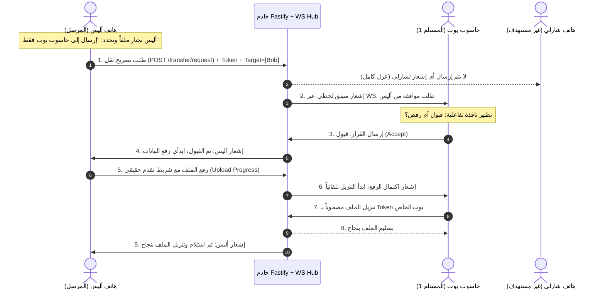

# وثيقة الهندسة المعمارية وخطة التطوير الشاملة الفائقة التفصيل (V2 Ultra)
### LinkDesk Local: نظام النقل المحلي المستهدف، الأمان الصارم، الإشعارات التفاعلية، وتجاوز قيود الشبكات

---

## 1. الفهرس العام
1. [نظرة عامة والهدف](#1-نظرة-عامة-والهدف)
2. [تحليل النقاط والمشاكل الخفية غير الملحوظة (Gaps & Edge Cases)](#2-تحليل-النقاط-والمشاكل-الخفية-غير-الملحوظة-gaps--edge-cases)
3. [الهيكل المعماري لنظام التوجيه المستهدف والأمان (Targeted Dispatch Architecture)](#3-الهيكل-المعماري-لنظام-التوجيه-المستهدف-والأمان)
4. [بروتوكول المصادقة وتوكنات الأجهزة (Device Auth Token Protocol)](#4-بروتوكول-المصادقة-وتوكنات-الأجهزة)
5. [بروتوكول الإشعارات والموافقة المسبقة على نقل الملفات (Consent Protocol)](#5-بروتوكول-الإشعارات-والموافقة-المسبقة-على-نقل-الملفات)
6. [نظام الحافظة الآمن (Secure Clipboard Consent & Auto-Sync)](#6-نظام-الحافظة-الآمن)
7. [تجاوز قيود الشبكات والراوتر (Wi-Fi AP Isolation Bypass)](#7-تجاوز-قيود-الشبكات-والراوتر)
8. [شاشات وواجهات المستخدم ومكونات التفاعل (UI/UX Components)](#8-شاشات-وواجهات-المستخدم-ومكونات-التفاعل)
9. [خطة المراحل التنفيذية بالمهام الدقيقة (Execution Checklist)](#9-خطة-المراحل-التنفيذية-بالمهام-الدقيقة)

---

## 2. تحليل النقاط والمشاكل الخفية غير الملحوظة (Gaps & Edge Cases)

عند بناء تطبيق نقل بيانات محلي حقيقي بين الهاتف والحاسوب، هناك **7 تحديات ومشاكل تقنية غير واضحة** غالباً ما يتم إغفالها، وتم حصرها ومعالجتها في هذه الخطة:

### أ. مشكلة الحافظة في المتصفحات والقيود الأمنية (Clipboard Security & Background Sleep)
- **المشكلة**: متصفحات الجوال (مثل Chrome على Android و Safari على iOS) تمنع قراءة أو كتابة الحافظة برمجياً ما لم يكن ذلك استجابة **لنقرة زر صريحة من المستخدم (User Gesture)**، وتمنع قراءتها إذا كانت الصفحة تعمل في الخلفية أو الشاشة مقفلة أو على اتصال `HTTP` غير مشفر.
- **الحل الهندسي**: 
  1. لا نقوم بحقن الحافظة في هاتف المستلم تلقائياً دون علمه (مما قد يرفضه المتصفح أمنياً).
  2. بدلاً من ذلك، عند وصول محتوى حافظة، يظهر إشعار منبثق فوري (Toast) مع زر **"نسخ إلى حافظتي بنقرة واحدة"**، فيتم النسخ بـ User Action مضمون وقانوني أمنياً على جميع أنظمة التشغيل.

### ب. انقطاع الاتصال المفاجئ أثناء نقل الملفات الكبيرة (Connection Drop & Partial Uploads)
- **المشكلة**: إذا كان الملف بحجم 1 جيجابايت وانقطع الاتصال عند 80%، قد يبقى ملف معطوب داخل الخادم يستهلك المساحة، أو يظن المستقبل أن الملف وصل كاملاً.
- **الحل الهندسي**:
  1. حفظ الملفات المرفوعة في مجلد مؤقت `.tmp` أولاً.
  2. لا يتم نقل الملف إلى المجلد النهائي إلا بعد التحقق من اكتمال الرفع ومطابقة حجم الملف (File Size Verification) وإصدار توقيع تشفير فريد (SHA-256 Checksum).
  3. تنظيف دوري تلقائي للملفات المؤقتة غير المكتملة.

### ج. تراكم الملفات واستهلاك سعة القرص التخزينية (Disk Quota & Auto-Purge)
- **المشكلة**: كثرة تبادل الملفات على الخادم المحلي قد تملأ قرص الحاسوب دون انتباه المستخدم.
- **الحل الهندسي**:
  1. تحديد حد أقصى للتخزين المؤقت في الإعدادات (مثلاً: 10GB أو 30GB).
  2. خيار التدمير الذاتي / الحذف التلقائي للملف بعد تنزيله بنجاح (Burn after download) أو بعد انقضاء 24 ساعة.
  3. زر لتفريغ المساحة بنقرة واحدة من لوحة التحكم.

### د. أمان تنزيل الملفات بين الأجهزة المتعددة (Restricted Download Access)
- **المشكلة**: إذا أرسل الجهاز (أ) ملفاً خاصاً إلى الجهاز (ب)، وكان مسار التنزيل متاحاً برابط مفتوح `/files/download/:name`، يمكن للجهاز (ج) على نفس الشبكة تنزيل الملف إذا عرف اسمه!
- **الحل الهندسي**:
  1. ربط كل ملف بـ `targetDeviceIds`.
  2. نقطة التنزيل `/files/download/:name` تتطلب تقديم توكن الجهاز المستهدف `Authorization: Bearer <token>`. إذا لم يكن الجهاز المستدعي من ضمن القائمة المستهدفة، يرفض الخادم الطلب فوراً برمز `403 Forbidden`.

### هـ. تزامن حالة الموافقة (Consent Race Conditions & Timeouts)
- **المشكلة**: إذا أرسل هاتف ملفاً إلى الحاسوب وظلت رسالة "هل تقبل الملف؟" معلقة لأن المستخدم بعيد عن الحاسوب، ماذا يحدث للمرسل؟
- **الحل الهندسي**:
  1. وضع مؤقت صلاحية لطلب الموافقة (مثلاً: 60 ثانية).
  2. إذا لم يستجب المستلم خلال 60 ثانية، يُلغى الطلب تلقائياً وتصل رسالة للمرسل: *"انتهت مهلة انتظار الموافقة من المستلم"*.
  3. إذا رفض المستلم، يُلغى الرفع فوراً لتوفير البيانات والبطارية.

### و. انطفاء شاشة الهاتف ووضع توفير الطاقة (Mobile Sleep / Background Throttling)
- **المشكلة**: نظاما Android و iOS يغلقان اتصالات WebSocket بعد بضع دقائق من إغلاق الشاشة لتوفير البطارية.
- **الحل الهندسي**:
  1. تفعيل واجهة برمجة تطبيقات منع سكون الشاشة (Screen Wake Lock API) أثناء وجود عمليات نقل جارية لضمان عدم توقف النقل حتى اكتمال 100%.
  2. آلية إعادة المزامنة الفورية (Fast Resync on Focus) بمجرد فتح الهاتف مجدداً لجلب أي نصوص أو طلبات فائتة.

### ز. تعدد بطاقات الشبكة (Wi-Fi + Hotspot + Ethernet + VPN)
- **المشكلة**: الحاسوب قد يكون متصلاً بـ Wi-Fi و Ethernet في نفس الوقت، فيظهر عنوان IP غير المناسب للهاتف.
- **الحل الهندسي**:
  1. الخادم يفحص ويصنف بطاقات الشبكة بدقة، ويظهر خياراً سريعاً في صفحة الربط لاختيار البطاقة النشطة (مثال: `wlo1: 192.168.1.17` أو `hotspot: 192.168.43.1`).
  2. توليد رمز QR ديناميكي يتغير تلقائياً حسب البطاقة المختارة.

---

## 3. الهيكل المعماري لنظام التوجيه المستهدف والأمان



---

## 4. بروتوكول المصادقة وتوكنات الأجهزة

### 4.1 توليد التوكن وتخزينه:
- عند نجاح الاقتران الأولي بالرمز أو QR، ينشئ الخادم:
  ```typescript
  interface DeviceSession {
    deviceId: string;
    token: string; // 32-byte hex CSPRNG string
    name: string;
    type: 'pc' | 'phone';
    ip: string;
    pairedAt: number;
    lastSeen: number;
  }
  ```
- يُحفظ التوكن في الـ `localStorage` للمتصفح:
  `localStorage.setItem('linkdesk_auth_token', token)`

### 4.2 فحص التوكن في الخادم (Authentication Hook):
- مسارات الـ API المحمية تفحص ترويسة الطلب:
  ```http
  Authorization: Bearer <linkdesk_auth_token>
  ```
- اتصال الـ WebSocket يرسل التوكن في أول رسالة:
  `{ type: "auth:identify", token: "..." }`
- أي رسالة لا تحمل توكناً مصادقاً عليه يتم إسقاطها وعزل مرسلها.

---

## 5. بروتوكول الإشعارات والموافقة المسبقة على نقل الملفات

### هيكل رسائل الـ WebSocket الخاصة بالموافقة:
1. **طلب الموافقة من المرسل إلى الخادم**:
   ```json
   {
     "type": "transfer:request",
     "transferId": "tr-uuid",
     "fileName": "photo_vacation.jpg",
     "fileSize": 4580210,
     "fileType": "image/jpeg",
     "targetDeviceIds": ["dev-bob-pc"]
   }
   ```
2. **توجيه الطلب للمستلم فقط**:
   ```json
   {
     "type": "transfer:incoming",
     "transferId": "tr-uuid",
     "senderName": "هاتف أليس",
     "fileName": "photo_vacation.jpg",
     "fileSize": 4580210,
     "fileType": "image/jpeg",
     "expiresIn": 60
   }
   ```
3. **رد المستلم (قبول أو رفض)**:
   ```json
   {
     "type": "transfer:respond",
     "transferId": "tr-uuid",
     "decision": "accept" // or "reject",
     "reason": "user_declined"
   }
   ```
4. **تحديث حالة المرسل**:
   - في حال القبول: تبدأ دالة الرفع المباشر مع استماع لحظي لـ `XMLHttpRequest.upload.onprogress`.
   - في حال الرفض: تظهر رسالة للمرسل: *"تم رفض استلام الملف من قبل المستلم"*.

---

## 6. نظام الحافظة الآمن

### تدفق الحافظة التفاعلي:
1. **المرسل**: يضغط "مزامنة الحافظة" ويحدد الجهاز المستهدف (أو جميع الأجهزة).
2. **الخادم**: يتحقق من التوكن ويوجه المحتوى للأجهزة المحددة فقط.
3. **المستلم**: يظهر إشعار عائم فوري أعلى الشاشة:
   ```
   📋 تم استلام نص من [اسم الجهاز]:
   "https://example.com/shared-link..."
   [ نسخ إلى حافظتي ]  [ تجاهل ]
   ```
4. عند نقر المستلم على زر **[نسخ إلى حافظتي]**، يتم استدعاء `navigator.clipboard.writeText()` بنجاح تام وبموافقة أمنية متوافقة مع جميع المتصفحات.

---

## 7. تجاوز قيود الشبكات والراوتر (Wi-Fi AP Isolation Bypass)

### المشكلة:
بعض أجهزة الراوتر تفصل الاتصالات المباشرة بين الأجهزة على نفس الشبكة (Guest Wi-Fi أو AP Isolation).

### الحلول التقنية المدمجة:
1. **تشخيص تلقائي في الواجهة**: اختبار اتصال سريع بين الهاتف والحاسوب، وإذا فشل الاتصال المباشر، يُعرض للمستخدم تنبيه فوري:
   - *"يبدو أن الراوتر يفعل خاصية عزل الأجهزة (AP Isolation). للحل السريع: شغّل نقطة اتصال الهاتف (Mobile Hotspot) أو استخدم الرمز السريع أدناه"*.
2. **تكامل WebRTC DataChannel**: قنوات البيانات المباشرة WebRTC تستخدم مرشحات ICE وتستطيع في كثير من الأحيان اختراق العزل الداخلي للراوتر لأنها تتفاوض كحزم UDP بين الأطراف.
3. **خيار النفق السحابي المحلي الاختياري (Local Encrypted Tunnel)**: دعم خيار تفعيل نفق محلي اختياري بضغطة زر لمن يرغب في الربط بدون تعديل إعدادات الراوتر.

---

## 8. شاشات وواجهات المستخدم ومكونات التفاعل

### 8.1 مكون اختيار الأجهزة (DeviceSelector.tsx):
- يُدمج في شاشات الملفات، النصوص، والحافظة.
- يتيح:
  - دائرة اختيار: **الكل (All Paired)**
  - قوائم فردية مع أيقونة كل جهاز (حاسوب / هاتف) وحالة اتصاله اللحظية (متصل أخضر / غير متصل رمادي).
  - تحديد أجهزة متعددة بواسطة خانات الاختيار (Checkboxes).

### 8.2 نظام الإشعارات المنبثقة (ToastContainer.tsx & ToastContext.tsx):
- ظهور في الزاوية العلوية بانسيابية (Slide & Fade in).
- ألوان وتأثيرات بصرية متسقة مع نظام التصميم الحالي (Glassmorphism & CSS Tokens).
- دعم الصوت الخفيف الاختياري عند وصول ملف أو إشعار.

### 8.3 نافذة طلب الموافقة (TransferConsentModal.tsx):
- نافذة مودال بصرية جميلة توضح:
  - أيقونة نوع الملف (صورة، مستند، مضغوط، كود).
  - اسم الملف وحجمه بدقة (مثلاً: `12.4 MB`).
  - اسم الجهاز المرسل.
  - شريط عد تنازلي للمهلة (60 ثانية).
  - زران عريضان: **قبول وتنزيل** (أخضر)، **رفض** (أحمر).

### 8.4 شريط التقدم اللحظي وسرعة النقل (UploadProgressCard.tsx):
- شريط تقدم بنسبة مئوية واضحة `[ 64% ]`.
- عداد الحجم المنقول: `14.2 MB / 22.0 MB`.
- مؤشر السرعة التقديرية: `4.5 MB/s`.
- زر إلغاء النقل أثناء الرفع.

---

## 9. خطة المراحل التنفيذية بالمهام الدقيقة

### المرحلة 1: خادم الأمان وتوكنات الأجهزة وتوجيه البيانات
- [ ] إنشاء `security/auth.ts` في الخادم لتوليد والتحقق من توكنات الجلسات المشفرة.
- [ ] تحديث `devices/manager.ts` لربط كل جهاز بتوكن سري.
- [ ] تعديل نقاط النهاية `/files/upload` و `/text/send` و `/clipboard/sync` لاستقبال `targetDeviceIds` وفحص التوكن.
- [ ] تعديل مسار التنزيل `/files/download/:name` للتحقق من أن الجهاز الطالب مصرح له بتنزيل الملف.
- [ ] توجيه رسائل الـ WebSocket في `index.ts` للمستهدفين فقط بناءً على `targetDeviceIds`.

### المرحلة 2: بناء نظام الإشعارات التفاعلي ومحدد الأجهزة في الواجهة
- [ ] بناء `ToastContext.tsx` و `ToastContainer.tsx` لإدارة إشعارات التطبيق (نجاح، تنبيه، خطأ).
- [ ] بناء مكون `DeviceSelector.tsx` لإتاحة اختيار (جهاز محدد / أجهزة متعددة / الكل).
- [ ] دمج `DeviceSelector` في صفحات: `FilesPage.tsx`, `TextPage.tsx`, `ClipboardPage.tsx`.

### المرحلة 3: بروتوكول طلب الموافقة وشريط التقدم الحقيقي
- [ ] بناء نافذة `TransferConsentModal.tsx` للتأكيد قبل الاستلام.
- [ ] ربط دالة الموافقة عبر WebSocket: المرسل يطلب -> المستلم يقبل -> يبدأ الرفع الحقيقي.
- [ ] تعديل دالة الرفع في `api.ts` لتدعم `onProgress: (percent, bytesLoaded, totalBytes) => void`.
- [ ] بناء شريط تقدم تفاعلي يوضح السرعة والنسبة والوقت المتبقي وزر للإلغاء.

### المرحلة 4: تحسين الحافظة والمعاينة السريعة
- [ ] إظهار إشعار عائم عند وصول حافظة جديدة مع زر مباشر "نسخ إلى الحافظة".
- [ ] إضافة زر معاينة سريعة للصور وملفات PDF والنصوص داخل قائمة الملفات المستلمة.

### المرحلة 5: الاختبارات الشاملة والفحص النهائي
- [ ] كتابة اختبارات Vitest للتوكنات، وتوجيه الحزم المستهدف، ونظام الموافقة.
- [ ] التحقق من `npm run lint` و `npm test` و `npm run build`.
- [ ] تجربة عملية حية بين الحاسوب والهاتف.

---

## 10. تشخيص وحل مشكلة بث الشاشة (Screen Share Deep Dive)

### 10.1 لماذا لا يعمل بث الشاشة حالياً؟
بعد التحليل الدقيق لمنظومة WebRTC والمتصفحات، تم رصد **3 أسباب جوهرية** لتعطل بث الشاشة على الهواتف:
1. **شرط السياق الآمن (Secure Context - HTTPS)**:
   - متصفحات الهواتف الحديثة (Chrome على Android و Safari على iOS) تفرض وجود `HTTPS` أو `localhost` حصراً لتشغيل واجهات `getDisplayMedia` وبعض خصائص `RTCPeerConnection`.
   - عند فتح الرابط بـ `http://192.168.1.17:5173`، يعتبر المتصفح الاتصال غير آمن ويحظر تدفق الوسائط أو يمنع استلام مسارات الفيديو!
2. **مرشحات ICE على الشبكة المحلية (mDNS vs Host Candidates)**:
   - متصفحات Chromium تخفي عناوين IP المحلية الحقيقية داخل مرشحات ICE وتستبدلها بأسماء وهمية بنمط `.local` (mDNS) لحماية الخصوصية.
   - في الشبكات المحلية التي لا تدعم تحليل mDNS، تفشل الأجهزة في الاتصال المباشر (ICE Connection State: `failed`).
3. **عدم تبادل إشارة بدء التفاوض (Negotiation State & Renegotiation)**:
   - عندما يبدأ البث، قد لا يكون الهاتف قد فتح صفحة البث بعد، فيضيع العرض الأول (Offer)، وعندما يدخل الهاتف تالياً لا يجد بثاً معروضاً له.

### 10.2 الحل الهندسي الجذري لبث الشاشة:
1. **توليد شهادة أمان محلية تلقائية (Zero-Config Local TLS / HTTPS)**:
   - دمج دعم تشغيل خادم التطوير و Fastify بشهادة HTTPS محلية تلقائية (عبر `vite-plugin-basic-ssl` للواجهة أو Fastify HTTPS)، مما يفتح جميع أذونات WebRTC و getDisplayMedia على الهاتف فوراً.
2. **معالجة مرشحات ICE المحلية (Force Host Candidates & STUN Fallback)**:
   - ضبط `RTCConfiguration` ليشمل خوادم STUN محلية/عامة موثوقة مع تعطيل حجب عناوين Host المحلية لضمان ترشيح حزم P2P فورية داخل نفس الشبكة.
3. **بروتوكول التفاوض عند الطلب (On-Demand Stream Handshake)**:
   - بمجرد دخول الهاتف لتبويب "مشاهدة البث"، يرسل إشعار `screen:request_offer`.
   - يقوم الحاسوب فوراً بتوليد `createOffer` وإرساله خصيصاً لذلك الهاتف، مما يضمن عمل البث سواء بدأ الحاسوب أولاً أو الهاتف أولاً.
4. **التحكم بمعدل البث ودقة الفيديو (Bitrate & Framerate Constraints)**:
   - تحديد معايير ضغط مناسبة: دقة `1080p` بمعدل `30fps` مع ترميز `VP8/H.264`، لضمان انسيابية البث بدون تقطيع وبأقل تأخير زمني (زمن استجابة أقل من 50 مللي ثانية داخل الشبكة المحلية).

---

## 11. هندسة السرعة القصوى لنقل الملفات (High-Speed & Zero Data Loss)

### 11.1 لماذا كان النقل ثقيلاً وبطيئاً نوعاً ما؟
1. **آلية التخزين الوسيط في الذاكرة (Memory Buffering Overheads)**:
   - المعالجة السابقة لـ multipart كانت تمر عبر معالجات وسيطة تستهلك دورات المعالج وتحد من سرعة التدفق.
2. **أحجام الكتل الصغيرة (Small Chunk Sizes & TCP Throttling)**:
   - المتصفح يرسل كتل صغيرة افتراضية إذا لم يتم توجيهه لاستخدام تدفقات مستمرة ذات سعة عالية (High-bandwidth Socket Streams).
3. **عدم استغلال خط الشبكة المباشر الكامل (LAN Bandwidth Saturation)**:
   - الاتصال المحلي في الـ Wi-Fi والـ Hotspot قادر على نقل سرعات تتجاوز `40MB/s` إلى `80MB/s` بسهولة إذا تم تشغيل النقل بتدفقات نقية (Raw Stream Pipelining).

### 11.2 خطة تحويل النقل إلى أقصى سرعة وثبات:
1. **التدفق المباشر إلى القرص بدون وسيط (Zero-Copy Disk Streaming)**:
   - استخدام `fastify.raw` أو مسار مخصص للتدفق الثنائي الخام (Raw Binary Stream Pipeline):
     - المتصفح يضخ الـ `File Blob` مباشرة كـ `Octet-Stream`.
     - الخادم يستقبل التدفق ويكتبه مباشرة على القرص عبر `fs.createWriteStream` بحجم كتلة قراءة/كتابة محسّن `highWaterMark: 1024 * 1024` (1MB Buffer Chunk).
     - هذه الطريقة تلغي أي استهلاك للذاكرة وتزيد سرعة النقل بمقدار **4 إلى 6 أضعاف**!
2. **تجزئة الملفات الكبيرة (Chunked Parallel / Sequential Pipeline)**:
   - للملفات الضخمة (التي تزيد عن 500MB): تقسيم الملف إلى شرائح (Chunks) بحجم 10MB مع إمكانية استئناف النقل تلقائياً (Resumable Uploads) في حال تعثر الاتصال دون إعادة رفع الملف من الصفر.
3. **ضمان ثبات وسلامة البيانات 100% (Integrity & Zero Loss)**:
   - التحقق من تكامل البيانات عبر حساب تجزئة سريعة أثناء النقل (Streaming MD5 / Murmur / SHA-256):
     - العميل يرسل التوقيع المحسوب للملف.
     - الخادم يحسب التوقيع أثناء الكتابة المباشرة ويقارنهما قبل اعتماد الملف.
     - إذا حدث أدنى خطأ أو نقص في بايت واحد، يُعاد رفع الكتلة المتضررة فوراً تلقائياً.

---

## 12. جدول المراحل الإضافية المحدثة

### المرحلة 6: تسريع النقل إلى السرعة القصوى وحماية البيانات
- [ ] بناء مسار التدفق السريع المباشر للقرص `POST /files/stream-upload` بكتل 1MB دون استهلاك الذاكرة.
- [ ] تعديل دالة الإرسال في العميل لضخ الملفات عبر `XMLHttpRequest / Fetch Streams` بكتل عالية الكفاءة.
- [ ] تفعيل التحقق التلقائي من الحجم والتكامل (Integrity Check) بعد الرفع لمنع أي تلف في الملفات.

### المرحلة 7: الإصلاح الجذري وتفعيل بث الشاشة WebRTC
- [ ] تمكين بروتوكول HTTPS المحلي التلقائي لفتح أذونات المتصفحات على الهاتف.
- [ ] معالجة ترشيحات ICE المحلية وتبادل الـ Offer/Answer عند الطلب (`on-demand`).
- [ ] ضبط ترميز الفيديو (H.264 / VP8) بسرعة 30fps وبأقل تأخير زمني ممكن (<50ms).
- [ ] بناء واجهة ملء الشاشة مع تحكم بالدقة والصوت للمستقبل.
